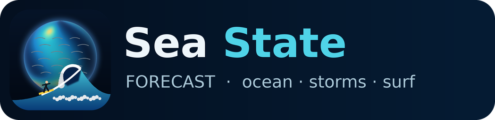
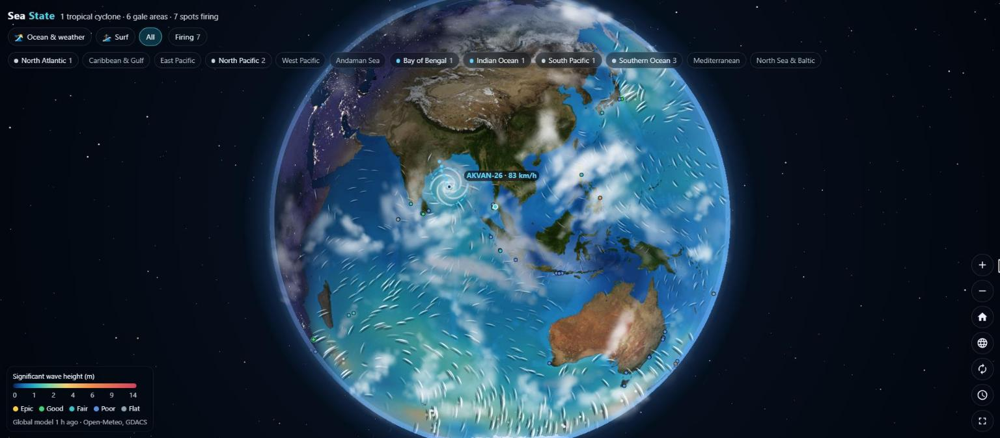
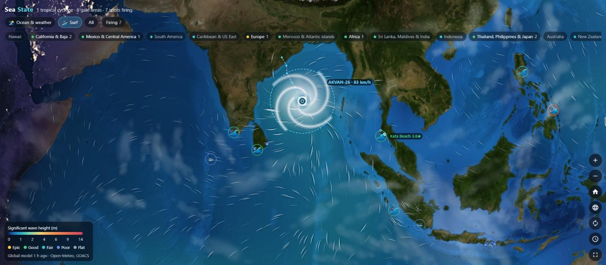
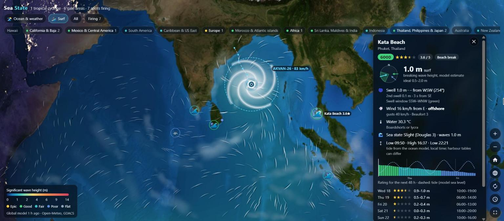
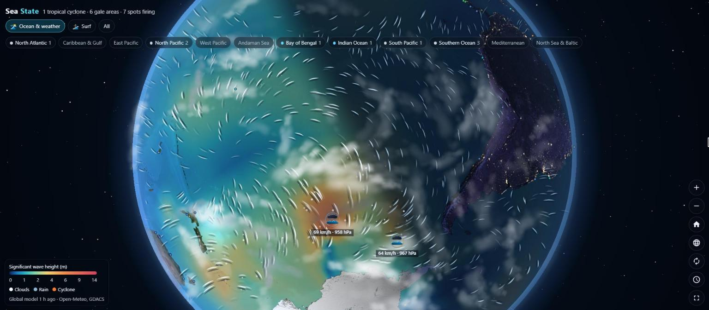
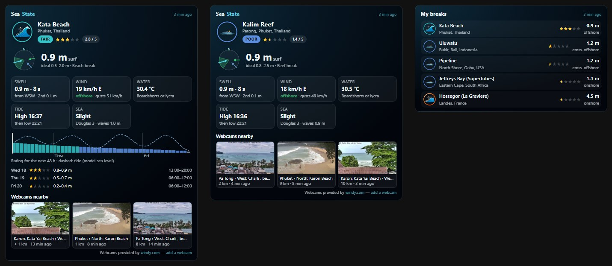
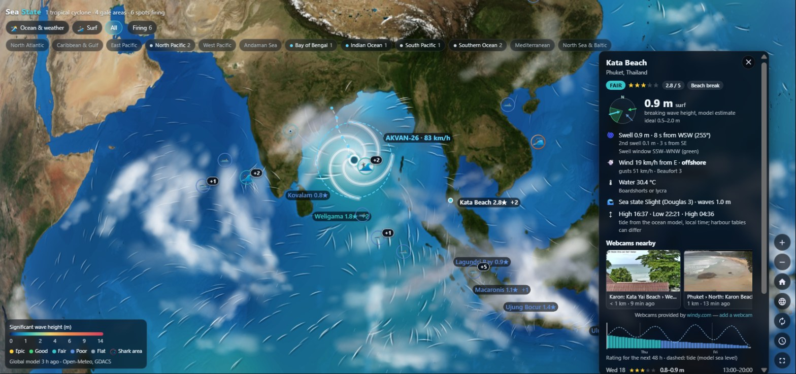
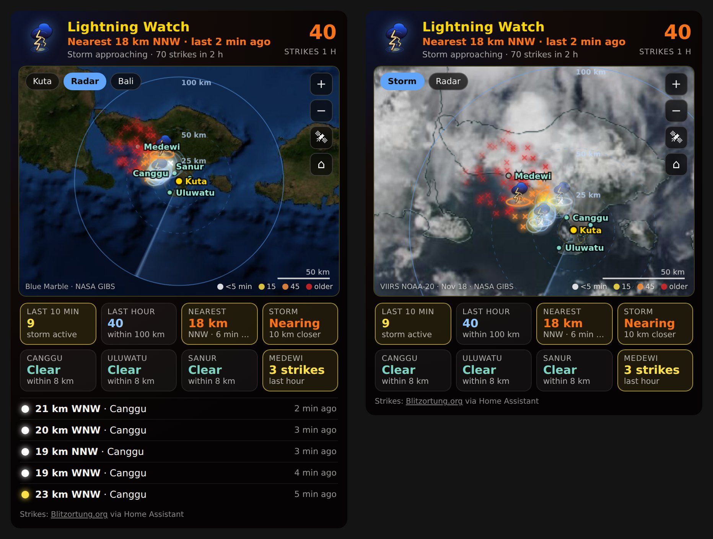

<p align="center">
  <picture>
    <source media="(prefers-color-scheme: dark)" srcset="custom_components/sea_state/brand/dark_logo@2x.png">
    <source media="(prefers-color-scheme: light)" srcset="custom_components/sea_state/brand/logo@2x.png">
    
  </picture>
</p>

<p align="center">
  <a href="https://github.com/hacs/integration"></a>
  <a href="https://github.com/mb26-dev/ha-sea-state/releases"></a>
  
  
  <a href="https://ko-fi.com/mb26dev"></a>
</p>

# Sea State Forecast

**Live ocean, storms and surf on a living globe for Home Assistant.** The whole planet's waves are painted onto a 3D Earth, wave crests roll in the direction the swell travels, clouds drift with the wind, rain falls, storms flash with lightning, tropical cyclones spin along their forecast track, and at 112 famous surf breaks a little surfer shows you right away whether it is flat, fun or firing.

One integration for two kinds of people: **weather and ocean watchers**, who want to see storms build and the sea get rough, and **surfers**, who want to know where and when the next good session is. A storm in the Southern Ocean today is the swell in Bali in five days, and Sea State Forecast shows both ends of that story.

No API key, no account.

<p align="center">
  
</p>

## Screenshots

| Surf mode with a tropical cyclone | Tap a spot for the full forecast |
| --- | --- |
|  |  |
| **Ocean & weather: Southern Ocean gales** | |
|  | Wave heights as colours, crests rolling with the swell, clouds drifting with the wind and gale areas with wind speed and pressure. Antarctica in the south, South America on the night side with its city lights. |

**Compact spot card for the home dashboard:** one spot or a list of spots, without the globe



**Webcams at the spot:** check the weather and the crowd before you go (optional, with a free Windy key)



**Lightning card for the home dashboard:** live strikes around home on a radar map (with the Blitzortung integration)



## Features

**Lovelace card** `custom:sea-state-card` (installed and registered automatically)

- Globe with real NASA imagery: daylight everywhere by default, or the real day and night with city lights at night, live terminator and sun glint on the water
- **Significant wave height** of all oceans as colours, from calm deep blue to phenomenal magenta
- **Rolling wave crests** that travel in the real wave direction; long period swell moves faster, high seas get white caps
- **Clouds, rain and lightning** from the global weather model, drifting with the wind
- **Tropical cyclones** (hurricanes, typhoons, cyclones) from GDACS as rotating spirals with their past and forecast track, coloured by category
- **Gale areas at sea** (Beaufort 8 and more) with wind and pressure
- **Surf spots** with a little surfer: sitting on a flat sea, paddling, riding, in the barrel when it is epic, a red flag when it is too big, spray when it is blown out
- **Compact spot card:** one spot or a list of spots for the home dashboard, without the globe, everything selectable in the visual editor
- **Lightning card:** live strikes around home on a radar map with range rings, the storm trend and your places, from the Blitzortung integration
- **Webcams (optional):** up to three live webcams near a spot, beach cams first, with the last daylight image at night (free Windy key)
- **Shark areas:** spots where sharks are part of the local ecosystem get a small shark marker, and their details name the species, the local safety measures and the official live service for the area
- **Three modes:** Ocean & weather, Surf, or All, plus a **Firing** filter for the spots that work right now
- **Region buttons:** surf regions (Hawaii, Indonesia, Europe ...) in surf mode, ocean basins (North Atlantic, West Pacific, Andaman Sea ...) in ocean mode, each with its number of firing spots or storms
- **Forecast button:** play the next 48 hours: waves, wind, clouds, rain and cyclones move on the globe, surfers change with the forecast
- Tap a **spot** for its rating, surf height, primary and secondary swell, wind (offshore, cross-shore or onshore), water temperature with wetsuit tip, sea state, tide times, a 48 hour rating chart with the tide curve, the best window for each of the next 7 days and a swell window compass
- Tap the **open sea** for wave height, period and direction, Douglas sea state, wind with Beaufort, clouds, rain and pressure
- Tap a **cyclone** for its category, wind, distance from home and closest forecast approach
- Metric or imperial units, following Home Assistant or set per card
- **Visual card editor**, **fullscreen button**, drag, pinch and mouse wheel, works on phones and wall tablets and pauses itself when it is not on screen

**Sensors** (entity IDs as created in an English Home Assistant)

| Entity | State | Attributes |
| --- | --- | --- |
| `sensor.sea_state_home_spot_rating` | surf rating of your home spot, 0 to 5 stars | condition, surf height, swell, secondary swell, wind and its angle, water temperature, wetsuit, sea state, best window today, next good session, tides, 7 day forecast |
| `sensor.sea_state_home_spot_condition` | flat, poor, fair, good, epic, blown out, too big | spot, surfer pose |
| `sensor.sea_state_home_spot_surf_height` | breaking wave height (m or ft) | spot |
| `sensor.sea_state_home_spot_swell_period` | peak period of the primary swell (s) | swell height, direction |
| `sensor.sea_state_home_spot_wind` | wind speed | direction, gusts, offshore / onshore, Beaufort |
| `sensor.sea_state_home_spot_water_temperature` | sea surface temperature | wetsuit |
| `sensor.sea_state_home_spot_sea_state` | Douglas sea state (calm to phenomenal) | Douglas code, wave height |
| `sensor.sea_state_home_spot_next_tide` | time of the next high or low tide | kind, level, the next tides |
| `sensor.sea_state_spots_firing` | spots worldwide at or above your firing rating | list with rating and surf height |
| `sensor.sea_state_best_spot_right_now` | the best rated spot on the planet | country, rating, surf height, period |
| `sensor.sea_state_tropical_cyclones` | active tropical cyclones | name, category, wind, alert, position, distance, GDACS link |
| `sensor.sea_state_nearest_tropical_cyclone` | name of the nearest cyclone | distance now, closest forecast approach and its time |
| `sensor.sea_state_gale_areas_at_sea` | areas with gale force winds at sea | position, wind, pressure, rain |
| `sensor.sea_state_<spot>_rating` | rating of each spot you picked | the full forecast like the home spot |
| shark attributes (spots in shark areas) | on the spot rating sensors | `shark_species`, `shark_measures`, `shark_service`, `shark_service_url` |
| `binary_sensor.sea_state_home_spot_firing` | on while your home spot is firing | rating, surf, swell, wind, best window |
| `binary_sensor.sea_state_tropical_cyclone_nearby` | on while a cyclone or its forecast track is within your radius | name, category, wind, distance, closest approach |
| `sensor.sea_state_data_sources` (diagnostic) | ok, degraded or waiting | status of every feed, number of ocean and land points |

If a source has not answered for 24 hours, Home Assistant shows a repair notice. The last known data stays on the globe, and the notice disappears by itself when the source answers again.

The integration is translated into English and German.

## Installation

### HACS (custom repository)

1. HACS → three dots → **Custom repositories** → add `https://github.com/mb26-dev/ha-sea-state` as **Integration**, or use this button:

   [](https://my.home-assistant.io/redirect/hacs_repository/?owner=mb26-dev&repository=ha-sea-state&category=integration)

2. Download **Sea State Forecast** and restart Home Assistant
3. **Settings → Devices & services → Add integration → Sea State Forecast**, or use this button:

   [](https://my.home-assistant.io/redirect/config_flow_start/?domain=sea_state)

### Manual

Copy `custom_components/sea_state` into your `config/custom_components` folder and restart Home Assistant.

## Configuration

All settings are done in the UI and can be changed later under **Configure**:

| Option | Default | Description |
| --- | --- | --- |
| Data sources | all | Global waves, global weather (wind, clouds, rain, pressure), surf spot forecasts, tropical cyclones. |
| Home spot | nearest spot to home | Gets the home spot sensors. |
| Spots with their own sensor | none | Each one gets a rating sensor with the full forecast. |
| Firing from rating | 3.5 | Rating from which a spot counts as firing. |
| Cyclone warning radius | 800 km | For the "Tropical cyclone nearby" sensor. |
| Global waves and weather update | every 12 hours | 6, 12 or 24 hours. The grid forecast covers 48 hours. |
| Custom spots | empty | Your own breaks, one per line: `name, lat, lon, swell direction[, offshore wind direction[, min, ideal, max surf height in m]]`, for example `My Reef, 7.81, 98.29, 250, 90, 0.5, 1.2, 2.5`. Directions are where the swell and the offshore wind come **from**, in degrees. |
| Windy webcams API key | empty | Optional. Shows up to 3 webcams near a spot in its details. See [Webcams](#webcams). |

**Open-Meteo usage:** the free Open-Meteo API allows 10,000 calls per day for non-commercial use, and every location in a request counts as one call. With the defaults Sea State Forecast uses about **4,600 calls per day** (global waves on a 6° grid, about 1,100 ocean points, and weather on a 9° grid, 760 points, every 12 hours; the 112 spots every 6 hours, waves and wind). Requests are split into chunks with pauses so the per minute limit is never reached. If you run other integrations that use Open-Meteo, set the global update to every 24 hours. The NASA Earth images (about 3 MB) are downloaded once; if [Orbitarium](https://github.com/mb26-dev/ha-orbitarium) or [Magmarium](https://github.com/mb26-dev/ha-magmarium) is installed, their images are used and nothing is downloaded.

## The card

```yaml
type: custom:sea-state-card
```

All options are optional:

```yaml
type: custom:sea-state-card
title: Sea State
height: 480            # height in px
mode: all              # all, ocean or surf
center: home           # home, world, a surf region, an ocean basin (see below) or [lat, lon]
zoom: 1.6              # 1 shows the whole globe
units: auto            # auto (like Home Assistant), metric or imperial
quality: auto          # auto, high or low (old wall tablets)
lighting: day          # day (daylight everywhere) or real (real day and night with city lights)
waves: true            # wave height colours
crests: true           # rolling wave crests
clouds: true
rain: true             # rain and lightning
cyclones: true
spots: true
sharks: true           # shark markers and details for spots in shark areas
webcams: true          # webcams near a spot (needs a Windy key in the integration)
labels: true           # names of firing spots
regions: true          # region buttons
forecast: true         # 48 hour forecast button
rotate: false          # slow rotation when nobody touches the card
```

Ocean basins for `center`: `north_atlantic`, `caribbean`, `east_pacific`, `north_pacific`, `west_pacific`, `andaman`, `bay_of_bengal`, `indian`, `south_pacific`, `southern_ocean`, `mediterranean`, `north_sea`.

### Compact spot card

For a quick look on your home dashboard there is a second card without the globe: `custom:sea-state-spot-card`. It shows one spot, or several spots as a list, in the same design. Add it from the card picker ("Sea State Spot") and pick what to show in the visual editor.


```yaml
type: custom:sea-state-spot-card
spot: home                # home spot, or a spot id such as kata or pipeline
days: 3                   # days in the outlook, 0 to hide
navigation_path: /dashboard-surf/globe   # optional: open the globe on tap
# everything is shown by default, switch off what you don't need:
surf: true                # surf height and swell window
swell: true
wind: true
water: true
tide: true
sea_state: true
chart: true               # rating for the next 48 h with the tide
next_good: true           # next good session when it's poor now
cyclone: true             # tropical cyclone within your warning radius
sharks: true
webcams: true             # needs a Windy key in the integration
```

Several spots as a compact list with surfer, stars, surf height and wind:

```yaml
type: custom:sea-state-spot-card
title: My breaks
spots: [kata, uluwatu, pipeline, jeffreys_bay]
```

### Lightning card

Thunderstorms are what ends a session the fastest. `custom:sea-state-lightning-card` shows the live strikes around your home on a zoomable map: NASA Blue Marble relief, or with the 🛰 button today's VIIRS satellite image. Range rings and a radar sweep around home, fresh strikes flash white and fade through yellow and orange to red, the newest one gets the animated lightning marker. Tiles show the strikes of the last 10 minutes and the last hour, the nearest one and the storm trend (nearing, moving away or steady), plus one tile per place, for example your favourite breaks. Tap a strike for distance, direction and time.

The strikes come from the [Blitzortung](https://github.com/mrk-its/homeassistant-blitzortung) integration (HACS), which creates a `geo_location` entity for every strike within its radius. Install it first and set its radius and time window to match the card.


```yaml
type: custom:sea-state-lightning-card
title: Lightning Watch
home_name: Kuta
radius_km: 100            # radar radius, like the Blitzortung radius
minutes: 120              # how long a strike stays on the map, like its time window
distance_entity: sensor.blitzortung_lightning_distance   # optional, for the "nearest" line
map: relief               # or satellite
height: 300
list: 5                   # newest strikes in the list, 0 to hide
places:
  - name: Canggu
    lat: -8.649
    lon: 115.13
    radius_km: 8
views:                    # buttons above the map, the first is the start view
  - name: Kuta
    radius_km: 30
  - name: Radar
    radius_km: 110
view: 1
```

Other options: `center: [lat, lon]` (default: your home), `source` (geo_location source, default `blitzortung`) or `entities` (a fixed list of geo_location entities).

### Surf spots and regions

| Key | Region | Spots |
| --- | --- | --- |
| `hawaii` | Hawaii | Pipeline, Sunset Beach, Waimea Bay, Jaws (Pe'ahi), Honolua Bay, Waikiki (Queens), Ala Moana Bowls |
| `california` | California & Baja | Mavericks, Ocean Beach, Steamer Lane, Rincon, Malibu (Surfrider), Huntington Beach Pier, Trestles (Lowers), Black's Beach, Todos Santos (Killers), Cox Bay |
| `central_america` | Mexico & Central America | Puerto Escondido (Zicatela), Barra de la Cruz, Popoyo, Punta Roca, Santa Teresa, Playa Hermosa, Pavones, Santa Catalina |
| `south_america` | South America | Chicama, Pico Alto, Punta de Lobos, El Gringo, Montanita, Joaquina, Saquarema (Itauna), Cacimba do Padre |
| `atlantic_americas` | Caribbean & US East | Tres Palmas, Soup Bowl, Cape Hatteras, Ditch Plains, Cocoa Beach |
| `europe` | Europe | Nazare (Praia do Norte), Supertubos, Coxos, Carcavelos, Mundaka, Zarautz, Hossegor (La Graviere), Cote des Basques, La Torche, Fistral Beach, Thurso East, Bundoran (The Peak), Mullaghmore Head, Westerland, Scheveningen, Klitmoller (Cold Hawaii), Unstad, Capo Mannu, Varazze, Hilton Beach |
| `morocco_islands` | Morocco & Atlantic islands | Anchor Point, Imsouane (The Bay), Safi, El Quemao, El Confital, Jardim do Mar |
| `africa` | Africa | Jeffreys Bay (Supertubes), Dungeons, Muizenberg, New Pier, Skeleton Bay, Ouakam, Busua, One Eye (Le Morne), Saint-Leu |
| `indian_ocean` | Sri Lanka, Maldives & India | Arugam Bay (Main Point), Hikkaduwa, Weligama, Pasta Point, Cokes, Kovalam |
| `indonesia` | Indonesia | Uluwatu, Padang Padang, Canggu (Echo Beach), Keramas, Desert Point, G-Land (Plengkung), Lagundri Bay, Lance's Right (HT's), Macaronis, Ujung Bocur |
| `asia` | Thailand, Philippines & Japan | Kata Beach, Kalim Reef, Pakarang Cape, Cloud 9, Sabang Beach, Tsurigasaki Beach, Kugenuma, Kisakihama |
| `australia` | Australia | Snapper Rocks (Superbank), Kirra, Burleigh Heads, Noosa Heads, The Pass, North Narrabeen, Bondi Beach, Bells Beach, Shipstern Bluff, Margaret River (Main Break) |
| `pacific` | New Zealand & Pacific islands | Manu Bay, Piha, Wainui Beach, Cloudbreak, Teahupo'o |

Positions, swell windows and size ranges are approximate and meant for a model based rating. Corrections and new spots are welcome as issues.

### Shark areas

Some of the best breaks in the world are also home to sharks. Sea State Forecast does not have live shark data: sightings, detections and beach closures are published by local services, and the card links to them.

| Area | Spots | Species | Official live service |
| --- | --- | --- | --- |
| Hawaii | all Hawaiian spots | Tiger sharks | [Hawaii DLNR Sharks](https://dlnr.hawaii.gov/sharks/) |
| California | Mavericks, Ocean Beach, Steamer Lane, Rincon, Malibu, Huntington, Trestles, Black's | White sharks | [California Fish and Wildlife](https://wildlife.ca.gov/Conservation/Marine/White-Shark) |
| US East Coast | Cape Hatteras, Ditch Plains, Cocoa Beach | Bull, blacktip, spinner and juvenile white sharks | [International Shark Attack File](https://www.floridamuseum.ufl.edu/shark-attacks/) |
| Western Australia | Margaret River | White sharks | [SharkSmart WA](https://www.sharksmart.com.au/shark-activity) |
| New South Wales | The Pass, North Narrabeen, Bondi | White, bull and tiger sharks | [SharkSmart NSW](https://www.sharksmart.nsw.gov.au/shark-activity) |
| Queensland | Snapper Rocks, Kirra, Burleigh Heads, Noosa | Bull and tiger sharks | [SharkSmart Queensland](https://www.dpi.qld.gov.au/news-media/campaigns/sharksmart) |
| Victoria | Bells Beach | White sharks, bronze whalers | [VicEmergency](https://vfa.vic.gov.au/education/shark-smart/quick-links/current-sightings-and-warnings) |
| Tasmania | Shipstern Bluff | White sharks | – |
| Cape Town | Muizenberg, Dungeons | White sharks | [Shark Spotters](https://sharkspotters.org.za) |
| Eastern Cape | Jeffreys Bay | White sharks | – |
| KwaZulu-Natal | New Pier (Durban) | Bull, tiger and white sharks | [KwaZulu-Natal Sharks Board](https://shark.co.za) |
| Réunion | Saint-Leu | Bull and tiger sharks | [Centre Sécurité Requin](https://www.info-requin.re) |

Shark bites are rare. This is background information, not a live warning: always check the local service and the lifeguards before you paddle out. Corrections and links for more areas are welcome as issues.

### Webcams

See the weather and how busy the beach is before you go. With a free [Windy](https://www.windy.com) webcams key, the details of a spot show up to three webcams within 15 km, beach and coast cams first, each with its distance and the age of the image. At night the last daylight image is shown. A tap opens the cam on Windy with its live view and timelapse.

1. Create a free account and key at [api.windy.com/keys](https://api.windy.com/keys) (product: Webcams API).
2. Paste the key into **Settings → Devices & services → Sea State Forecast → Configure → Windy webcams API key**.

The webcams are only fetched when you open a spot and are kept for a few minutes, so a key stays far below its limits. Leave the field empty to turn the webcams off; the card option `webcams: false` hides them on a single card. Not every spot has a webcam nearby.

## How the rating works

| Step | What happens |
| --- | --- |
| Surf height | Each swell (primary, secondary and the wind sea) is weighted by how well its direction fits the swell window of the spot and by its period (long period swell grows more when it reaches shallow water), and the parts are added up by energy. |
| Size | The surf height is compared with the size range of the spot: too small, ideal, or too big. |
| Period | Longer periods mean cleaner, more powerful waves. |
| Wind | Offshore and light winds are good, onshore winds spoil the waves. The wind is rated by its speed and its angle to the offshore direction of the spot. |
| Rating | 0 to 5 stars from size, period and wind; the condition (flat, poor, fair, good, epic, blown out, too big) decides the surfer on the globe. |

The ratings are a transparent model on top of global forecast data, not a local surf report. Banks, reefs, local winds and crowds are not in any global model. For safety at sea follow your local forecast and warnings.

## Notifications (blueprints)

**Your spot is firing**

[](https://my.home-assistant.io/redirect/blueprint_import/?blueprint_url=https%3A%2F%2Fgithub.com%2Fmb26-dev%2Fha-sea-state%2Fblob%2Fmain%2Fblueprints%2Fautomation%2Fsea_state%2Fspot_firing.yaml)

The actions get the variables `spot`, `rating`, `condition`, `surf_m`, `swell_m`, `swell_period_s`, `wind_kmh`, `wind` and `best_today`, for example:

```yaml
- action: notify.notify
  data:
    title: "{{ spot }} is firing ({{ rating }} stars)"
    message: "{{ surf_m }} m, {{ swell_period_s }} s, wind {{ wind }}. Best today {{ best_today }}."
```

**Tropical cyclone nearby**

[](https://my.home-assistant.io/redirect/blueprint_import/?blueprint_url=https%3A%2F%2Fgithub.com%2Fmb26-dev%2Fha-sea-state%2Fblob%2Fmain%2Fblueprints%2Fautomation%2Fsea_state%2Fcyclone_nearby.yaml)

The actions get `name`, `kind`, `category`, `wind_kmh`, `alert`, `distance_km`, `closest_approach_km`, `closest_approach_time` and `url`.

## Support

If Sea State Forecast gets you to the beach at the right time, a coffee keeps the swell coming. ☕🏄

<a href="https://ko-fi.com/mb26dev"></a>

A star on GitHub, a bug report or a screenshot of your dashboard helps just as much. Thank you!

## Credits

- Waves, swell, sea surface temperature, sea level, wind, clouds, rain and pressure: [Open-Meteo](https://open-meteo.com) (CC BY 4.0), with the marine models of ECMWF, Météo-France, DWD and NOAA that Open-Meteo combines
- Tropical cyclones: [GDACS](https://www.gdacs.org), the Global Disaster Alert and Coordination System of the United Nations and the European Commission, with data from JTWC and NOAA
- Earth imagery: NASA Earth Observatory, [Blue Marble Next Generation](https://science.nasa.gov/earth/earth-observatory/blue-marble-next-generation/) by Reto Stöckli and [Black Marble 2016](https://science.nasa.gov/earth/earth-observatory/earth-at-night/maps)
- Logo, surfer, shark, storm and cyclone markers and mode icons: original artwork by mb26-dev
- Shark areas link to the official services listed above; their data stays with them
- Webcams (optional, with your own key): webcams provided by [windy.com](https://www.windy.com) through the Windy Webcams API
- Lightning strikes: [Blitzortung.org](https://www.blitzortung.org) through the Blitzortung integration for Home Assistant; map tiles of the lightning card: [NASA GIBS](https://earthdata.nasa.gov/gibs) (Blue Marble shaded relief, VIIRS true colour, coastlines)
- Lightning marker: original artwork by mb26-dev
- Waves, crests, clouds, rain and cyclone spirals on the globe are drawn by the card itself

See [THIRD_PARTY_NOTICES.md](THIRD_PARTY_NOTICES.md) for details.
